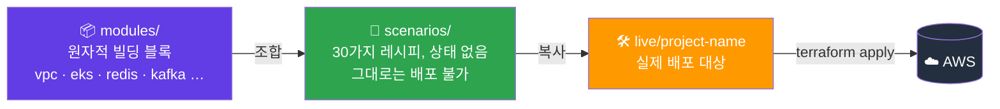

<div align="center">

[🇺🇸 English](README.md) · **🇰🇷 한국어**

# 🚀 aws-launcher

**시나리오를 고른다. 복사한다. 배포한다.**

AWS를 위한 개인용 Terraform 런치패드 — 원자적 모듈, 이를 조합한 시나리오, 형식적으로 명세된 런타임 동작, 그리고 IaC 품질 파이프라인까지. 그냥 읽고 넘기는 게 아니라 실제로 직접 만들어보며 배우기 위해 만든 프로젝트다.


</div>

---

> 🎓 **이 프로젝트는 Claude와 함께 만든 개인 학습 프로젝트다.** 잘 다듬어진 제품도, 어느 회사의 공식 IaC 라이브러리도 아니다 — Terraform, AWS, SRE 실무, 그리고 형식 명세(TLA+)를 AI 페어링 파트너와 실제로 뭔가를 만들면서 직접 배우기 위한, 실수까지 포함된 한 사람의 실습용 도구다. 여기 있는 모든 모듈, 시나리오, TLA+ 명세는 [Claude](https://claude.com/claude-code)와의 이 지속적인 세션에서 나왔다 — 설계 결정, 보안 스캐너나 모델 체커가 실제로 잡아낸 진짜 버그(그리고 나중에 오탐으로 판명난 것들), 그리고 사람이 직접 풀어나가야 할 [`backlog.md`](#-학습-백로그) 학습 태스크까지, 전부 그 과정의 일부이지 그대로 베껴도 되는 완성품이 아니다. 애매한 판단이 필요했던 결정들의 *이유*는 `backlog/decisions/`를 읽어보고, 이 코드에 실제로 도구를 돌렸을 때 무엇이 나오는지 — 아직 열려 있는 것들까지 포함해서 — 는 [리포 지표](#-리포-지표)를 참고할 것.

---

## 🧭 멘탈 모델



**왜 `source = "../../scenarios/x"` 대신 복사를 쓰나?** `live/<project>`로 한 번 복사하고 나면 그건 온전히 내 것이 된다 — 자유롭게 고쳐도 되고, 나중에 시나리오 템플릿이 개선되더라도 밑에서 갑자기 바뀌지 않는다. 트레이드오프는 이미 배포된 프로젝트에 개선사항이 자동으로 전파되지 않는다는 것 — 이건 의도된 설계다. 프로덕션 인프라가 템플릿이 바뀌었다는 이유만으로 같이 움직여서는 안 된다.

---

## 📋 목차

- [새 프로젝트 시작하기](#-새-프로젝트-시작하기)
- [최초 1회 설정](#-최초-1회-설정)
- [모듈 테스트](#-모듈-테스트)
- [커스텀 정책 검사](#-커스텀-정책-검사)
- [기술 스택 & 기법](#-기술-스택--기법)
- [리포 지표](#-리포-지표)
- [모든 시나리오에 적용하려는 SRE 원칙](#-이-리포가-지향하는-sre-원칙-그리고-솔직히-부족한-부분)
- [모듈 (36개)](#-모듈-36개)
- [시나리오 (30개)](#-시나리오-30개)
- [형식 명세 (TLA+)](#-형식-명세-tla)
- [참고 예제](#-참고-예제)
- [학습 백로그](#-학습-백로그)

---

## 🏁 새 프로젝트 시작하기

1. `scenarios/` 아래에서 가장 가까운 것을 고른다 — [전체 목록](#-시나리오-30개) 참고.
2. 복사한다: `cp -r scenarios/<slug> live/<your-project-name>`
3. `backend.tf`(버킷 이름은 `bootstrap/`에서), `providers.tf`의 리전, `variables.tf`/새 `terraform.tfvars`를 채운다.
4. 이 프로젝트의 실제 가용성/지연시간 목표로 `SLO.md`를 채운다.
5. 로컬에서 `terraform init && terraform plan`을 돌린 뒤 PR을 연다 — `terraform-ci.yml`이 fmt/validate/tflint/trivy/checkov/conftest/terraform-test를 돌리고 plan + 비용 diff를 PR 코멘트로 올려준다.
6. `main`에 머지하면 → `terraform-apply.yml`이 적용한다(`production` GitHub Environment의 수동 승인 뒤에 게이트됨).

## ⚙️ 최초 1회 설정

| 단계 | 할 일 |
|---|---|
| 🪣 상태 백엔드 | AWS 계정/리전당 한 번 `bootstrap/`을 실행해 S3 상태 버킷을 만든다. 락은 S3 네이티브 방식(`use_lockfile`, Terraform >= 1.11)이라 DynamoDB 테이블이 필요 없다(`bootstrap/README.md` 참고) |
| 🔑 CI 자격증명 | `modules/iam-github-oidc`로 역할 두 개를 만든다 — 좁은 권한의 `plan` 역할(`AWS_PLAN_ROLE_ARN`)과 `refs/heads/main`에 한정된 더 넓은 `apply` 역할(`AWS_APPLY_ROLE_ARN`). GitHub에 장기 AWS 키가 절대 올라가지 않는다 |
| 💰 Infracost | `INFRACOST_API_KEY` 레포 시크릿을 추가한다(infracost.io에서 무료 키 발급) |
| 💻 로컬 개발 | `pip install pre-commit && pre-commit install` 실행 후, CI 밖에서도 도는 도구들을 위해 `brew install terraform-docs checkov conftest k6` |

## 🧪 모듈 테스트

`modules/vpc`, `modules/s3-bucket`, `modules/iam-github-oidc`는 Terraform의 네이티브 테스트 프레임워크 + `mock_provider`를 사용하는 `tests/*.tftest.hcl`을 갖고 있다 — **AWS 자격증명 없이, 몇 초 만에 실행됨**:

```bash
cd modules/vpc && terraform init -backend=false && terraform test
```

[학습 백로그](#-학습-백로그)에서 다른 모듈을 진행하면서 이 패턴을 계속 확장할 것; `terraform-ci.yml`은 `tests/` 디렉터리가 있는 모든 모듈에 대해 자동으로 `terraform test`를 돌린다.

## 🛡️ 커스텀 정책 검사

`policy/`에는 `terraform plan` JSON에 대해 실행되는 Conftest(OPA/Rego) 정책들이 있다 — 일반 스캐너가 못 잡는 레이어다. Trivy/Checkov는 *알려진* misconfiguration을 잡는 반면, Conftest는 *이 리포만의* 규칙을 강제한다(예: 어떤 미래의 시나리오가 어떻게 선언하든 퍼블릭 S3 버킷은 안 됨). deny-vs-warn 컨벤션은 `policy/README.md` 참고.

## 🧱 기술 스택 & 기법

이 리포에서 쓰는 모든 것을 한곳에 모아뒀다 — 이 목록 자체가 [학습 백로그](#-학습-백로그)의 커리큘럼이다: 각 행은 설치만 하고 끝낼 게 아니라 실제로 이해해야 할 대상이다.

"모듈 vs 시나리오"가 아니라 **스코프** 기준으로 정리했다 — 시나리오는 결국 모듈을 조합한 것뿐이라 여기 있는 도구 대부분이 둘 다에 동일하게 적용된다. 실제로 다른 건 *도구가 돌아가기 전에 무엇이 존재해야 하는가*다:

- **모듈 스코프**: 조합 없이 모듈 하나만으로 동작, AWS 자격증명이 필요 없는 경우가 많음
- **조합된 스택 스코프**: 모듈들이 실제로 엮인 `terraform plan`이 필요함(즉 `scenarios/*` 레시피가 `live/*`로 복사된 상태)

### 코어 (어디에나 적용됨)

| 목적 | 도구/기법 |
|---|---|
| IaC 언어 & 런타임 | Terraform >= 1.5(`live/*` 스택은 >= 1.11 — S3 네이티브 락), HCL, AWS provider `~> 5.0` |
| 상태 백엔드 | S3(버저닝, 암호화) |
| 상태 락 | **S3 네이티브 락**(`use_lockfile = true`, Terraform >= 1.11) — DynamoDB 기반 락은 업스트림에서 deprecated됨; `bootstrap/`은 더 이상 락 테이블을 만들지 않는다 |
| 버전 관리 | Git + GitHub(레포/PR 관리는 `gh` CLI) |
| CI/CD | GitHub Actions(`terraform-ci`, `terraform-apply`, `drift-detect`) |
| CI 자격증명 | GitHub OIDC 연동(`iam-github-oidc`) — 장기 AWS 키가 GitHub에 닿는 일이 절대 없음 |

### 모듈 스코프 검증 (조합 없이 모듈 하나만)

| 도구/기법 | 무엇을 검사하나 | CI에서 블로킹? |
|---|---|:---:|
| `terraform validate`, `terraform fmt` | HCL이 파싱/포맷이 되는지 | ✅ |
| TFLint(+ AWS 룰셋) | AWS 특유의 함정(deprecated 인자, 잘못된 인스턴스 타입 등) | ✅ |
| **`precondition`/`postcondition`**(`lifecycle` 블록) — **36개 모듈 전부** | "이 값은 항상 성립해야 한다" — 테스트 스위트에서만이 아니라 **모든** plan/apply에서 검사됨. TLA+ 같은 것의 이 생태계 내 대안이라 볼 수 있다: Terraform 모듈은 선언적 리소스 그래프이지 동시성 알고리즘이 아니라서 모델 체커가 탐색할 만한 의미있는 상태 공간이 없다 — 하지만 TLA+가 추구하는 *목표*(명시적이고 검증된 불변식)는 `precondition`/`postcondition`, `check` 블록으로 그대로 매핑된다 | ✅(apply 실패) |
| `terraform test`(네이티브, `mock_provider`) | 다양한 입력 조합에서의 모듈 동작, 완전히 오프라인, AWS 자격증명 불필요 | `tests/`가 있는 모듈은 ✅ |
| terraform-docs | 모든 모듈의 Inputs/Outputs 표(`<!-- BEGIN_TF_DOCS -->` 블록)가 실제 코드와 일치하는지 | ✅ 드리프트 시 실패 |
| gitleaks | 실수로 커밋된 시크릿 | ✅(pre-commit *과* CI 둘 다 — 아래 노트 참고) |

> **왜 gitleaks가 두 군데에서 다 도나:** pre-commit은 커밋이 일어나기 전에 잡아내지만, 기여자가 pre-commit을 설치했을 때만 작동한다. CI는 그와 무관하게 잡아내는 안전망이다 — pre-commit에서만 시크릿을 스캔하는 리포는 그걸 건너뛴 사람에게 구멍이 생긴다.

### 조합된 스택 스코프 (모듈들이 엮인 실제 plan 필요)

| 도구/기법 | 무엇을 검사하나 | CI에서 블로킹? |
|---|---|:---:|
| Trivy(config scan) | 알려진 AWS misconfiguration | ⚠️ 논블로킹, 아래 노트 참고 |
| Checkov(2차 의견) | 같은 카테고리, 다른 탐지 커버리지 — 성숙한 IaC 스택은 둘을 병행해서 돌린다 | ⚠️ 논블로킹, 아래 노트 참고 |
| Conftest(OPA/Rego), `policy/` | *이 리포만의* 규칙, 일반적인 게 아니라(예: 미래의 시나리오가 뭘 하든 퍼블릭 S3 버킷 금지) | `deny` ✅ / `warn` ❌ |
| Infracost | 비용 diff — 정보성 PR 코멘트 | ❌ 블로킹 아님 |
| k6(`tools/loadtest/`, `.github/workflows/loadtest.yml`) | 각 스택의 `SLO.md` 임계값 기준으로 트래픽 스파이크를 재현 | 수동 `workflow_dispatch` — AWS 자격증명 불필요, `tools/loadtest/README.md` 참고 |
| 스케줄된 `terraform plan -detailed-exitcode`(드리프트 탐지) | 실제 인프라가 코드와 조용히 어긋나는 것(driftctl은 더 이상 유지보수되지 않음 — 이게 현재로선 실질적인 대안) | 추적용 이슈를 열 뿐 PR을 막지는 않음 |

> **왜 Trivy/Checkov가 여기서 논블로킹인가:** 이 리포의 모듈들은 의도적으로 최소한으로 만들어졌다(각 모듈의 *"아직 포함되지 않은 것"* 섹션 참고) — 예를 들어 Redshift는 KMS로 암호화되지 않고, SNS/SQS는 기본적으로 암호화되지 않는다. 두 스캐너 모두 이걸 정확하게 실제 findings로 잡아낸다; 이건 버그가 아니라 스캐폴드 단계에서 받아들인 트레이드오프다. 그래도 가시성을 위해 모든 PR에서 계속 돌고 리포트된다(`continue-on-error`). 특정 프로젝트가 스캐폴드에서 실제 프로덕션 워크로드로 졸업하면 그때 블로킹으로 전환하면 된다.

### 로컬 개발 오케스트레이션

| 도구 | 하는 일 |
|---|---|
| pre-commit | 모든 커밋 전에 fmt, validate, tflint, terraform-docs, trivy, checkov, gitleaks |

## 📊 리포 지표

위 도구들을 지금 이 리포에 실제로 돌렸을 때 나오는 것 — 희망사항이 아니라 실제 스냅샷이고, 이미 전수 감사를 한 차례 거쳤다(아래 참고):

| 지표 | 결과 |
|---|---|
| tflint(전체 리포) | 오류/경고 0개; `info` 레벨 알림 322개(변수/출력의 `description` 누락 — [`TASK-175`](backlog/tasks)로 추적 중, 아직 시작 안 함) |
| checkov(36개 모듈) | 338 통과 / 19 실패(94.7%) — 남은 실패는 전부 해당 모듈 README의 *"아직 포함되지 않은 것"* 노트와 매칭되고, 대부분은 명시적 백로그 태스크로 추적됨(아래 참고) |
| trivy config(36개 모듈) | 30개 misconfiguration — checkov와 같은 카테고리, 2차 의견용 스캐너, 동일한 감사 커버리지 |
| `precondition`/`postcondition` 블록 | 37개(precondition 34 + postcondition 3) — 모든 `plan`/`apply`마다 강제되는 실제 AWS API 불변식 |
| `terraform test` 파일 | 3개(`vpc`, `s3-bucket`, `iam-github-oidc`) |
| Conftest 정책(`policy/`) | 2개(`deny` 1, `warn` 1) |
| gitleaks(전체 git 히스토리) | 0건 |
| TLA+ / TLC(66개 명세: 시나리오 30 + 모듈 36) | 0 실패, 아래의 모듈 수정마다 재확인함 |
| 코드 라인 수([tokei](https://github.com/XAMPPRocky/tokei)) | HCL 6,030+ · TLA+ 3,925(`tokei`가 `.tla`를 인식 못해 별도 카운트) · 백로그 학습 태스크 파일 316개(11,736줄) |
| Infracost | 로컬에서는 실행 안 함 — 직접 시도해보고 확인함: Homebrew로 설치한 최신 CLI(`v2.16.2`)는 `infracost scan`조차 브라우저 OAuth 로그인이 필요하고, CI가 쓰는 `infracost diff`/`infracost comment`는 *그 버전에서* deprecated 상태다. CI 워크플로 자체는 문제없다: `infracost/actions/setup@v3`가 기본으로 CLI `0.10.x`를 까는데, 거기선 `diff`/`comment`가 여전히 정상 동작하는 명령이다 — 그러니 이건 "최신 CLI를 대신 로그인해서 돌려줄 수 없다"는 문제일 뿐, 파이프라인이 고장난 게 아니다. `INFRACOST_API_KEY` 레포 시크릿을 얻으려면 여전히 본인이 직접 한 번은 `infracost auth login`을 해야 한다([최초 1회 설정](#-최초-1회-설정) 참고) |

### checkov/trivy 감사 (실제로 있었던 일)

이 표의 첫 버전은 "checkov 79건 / trivy 52건 실패, 아직 문서와 교차검증 안 됨"이라고 적혀 있었다. 그 감사가 실제로 진행됐다 — findings가 79→45(checkov), 52→40(trivy; 도중에 새 finding이 하나 생겼다 — 아래 `dms` 노트 참고 — 그래서 깔끔하게 줄기만 한 건 아니다)로 줄었고, 세 갈래로 나뉘었다:

- **공짜로 고친 것**(~20건): 보안 그룹 규칙 설명, `auto_minor_version_upgrade`, SNS/SQS/Athena의 AWS 관리형 키 기본 암호화, CloudFront의 `default_root_object`/TLS 1.2 최소 버전, ALB 헤더 드롭, Lambda X-Ray 트레이싱, Step Functions 로깅 + 트레이싱, WAF의 Log4Shell 룰셋, RDS IAM 인증 + Performance Insights, SageMaker 네트워크 격리.
- **스캐너 트집이 아니라 진짜 보안 구멍이라서 고친 것**: `ecs-service`는 ALB 뒤에 있어도 컨테이너 포트가 `0.0.0.0/0`에 열려 있었다 — 이제 ALB의 보안 그룹이 있으면 거기로 범위를 좁힌다. `redshift`는 `publicly_accessible`이 아예 설정돼 있지 않았는데, Redshift는(RDS와 달리) 실제로 이 값이 기본 `true`다 — 이제 명시적으로 `false`. `dms`는 보안 그룹이 아예 없어서 VPC의 기본 SG로 조용히 새고 있었다 — 이제 하나 만들었다(아웃바운드 전용, 원래 이 리소스는 나가는 연결만 만들기 때문). 이 중 두 개는 남아 있던 `tflint`의 미사용 변수 경고(`vpc_id`가 선언만 되고 안 쓰임)를 따라가다 발견했는데, 알고 보니 죽은 코드가 아니라 진짜 빠진 인프라를 가리키고 있었다.
- **문서화된 트레이드오프로 남긴 것**(나머지): 대부분 "고객 관리형 KMS 키를 써라"(암호화는 이미 AWS 관리형 키로 전부 켜져 있다 — 키를 누가 관리하느냐의 문제일 뿐)와 진짜 새 인프라가 필요한 것들(액세스 로그 버킷, enhanced monitoring용 IAM 역할, VPC에 붙인 Lambda). 이것들 전부 해당 모듈 README에 구체적인 노트가 있지, "의도적으로 최소화함" 같은 뭉뚱그린 말로 넘어가지 않는다.

이 감사 자체가 드러낸 것 하나: 이 표의 예전 버전에 있던 `tflint`의 "0 findings" 주장은 **틀렸다** — `aws` 플러그인이 조용히 로드 실패한 상태였고(플러그인 캐시가 낡아서), 리포 대부분이 실제로는 전혀 검사되고 있지 않았는데 우연히 깨끗해 보였을 뿐이다. `tflint --init`을 다시 돌리자 진짜 숫자(info 레벨 322건, 실제 오류 0건)와 위의 `vpc_id` 경고 두 건이 드러났다. 기록으로 남겨두는 교훈: "0 findings"라는 결과는 그 도구가 검사해야 할 모든 곳에서 실제로 돌았다는 걸 확인했을 때만 믿을 수 있다.

이후 두 번째 `tflint --recursive` 스캔에서 같은 부류의 함정이 다른 각도로 또 발견됐다: 리포 루트에서 실행하면 전체 트리에 걸쳐 **0 issues**라고 조용히 보고했는데 — `tflint`는 상위 디렉터리의 `.tflint.hcl`을 찾아 올라가지 않고 정확히 현재 작업 디렉터리에서만 찾는다. 그래서 `--config "$(pwd)/.tflint.hcl"`을 명시적으로 안 주면 `--recursive`가 하위 디렉터리로 내려가는 순간 커스텀 룰셋을 잃어버린다. `--config`를 명시적으로 넘기고 나서야 진짜 322건이 다시 나타났다. 누군가 이 오해를 부르는 명령을 다시 돌리고 "더 할 게 없다"고 결론 내리는 일이 없도록 [`TASK-175`](backlog/tasks)로 추적 중이다.

### 2라운드: 남은 findings 마무리 (Security & Observability Hardening)

위에서 "문서화된 트레이드오프로 남긴 것"들도 그냥 놔두지 않고 다시 들여다봤다 — checkov/trivy를 재실행하고, 남은 실패 하나하나를 `backlog` CLI로 새 마일스톤 **Security & Observability Hardening**(`m-17` — 아래의 모듈/시나리오 *학습* 마일스톤들과는 별개다, 이건 사람이 풀어나갈 개념이 아니라 실제로 고쳐야 할 엔지니어링 태스크이기 때문) 아래 명시적인 `bug` 타입 태스크로 기록했다. 최근 기준 43개 중 **42개**가 닫혔다: **checkov 45→19건 실패(94.7% 통과)**, **trivy 40→30건**. `m-17` 아래 남은 백로그가 지금 아직 열려 있는 것들의 정직한 목록이다 — [`backlog/tasks`](backlog/tasks)를 보거나 `backlog task list -m "Security & Observability Hardening" --plain`을 실행할 것.

실제로 고친 것은 대략 진행된 순서대로:
- **선택적 고객 관리형 KMS 키**를 15개 모듈에 추가(`dms`, `amazon-mq`, `dynamodb`, `ecr`, `secrets-manager`, `aws-backup`, `rds-postgres`, `redshift`, `sns-sqs`, `observability`, `s3-bucket`, `lambda`, `step-functions`, `elasticache-redis`, `glue`, `msk-kafka`) — 전부 기본값이 `null`인 변수라 AWS 관리형 키로 폴백한다(하위 호환, 옵트인, 강제 비용 없음).
- **공짜로 메꾼 진짜 기능 공백** — 기본값이 꺼져 있던 게 아니라 아예 존재하지 않았던 것들: `amazon-mq`, `msk-kafka`, `api-gateway`의 액세스/브로커 로깅, `redshift`의 enhanced VPC routing.
- **옵트인으로 메꾼 진짜 기능 공백**(켜면 실제 비용이 듦, 기본은 꺼짐): `eks`의 컨트롤 플레인 로깅 + `public_access_cidrs`, `elasticache-redis`의 AUTH 토큰, `vpc`의 flow logs, `ec2`의 상세 모니터링, `ecs-service`의 Container Insights, `alb`/`cloudfront`의 삭제 보호/액세스 로깅/WAF 연결/지역 제한, `rds-postgres`의 log exports + enhanced monitoring(켤 때만 만들어지는 자체 IAM 역할 포함), `redshift`의 감사 로깅, `lambda`의 DLQ/동시성 제한/환경변수 KMS/VPC 연결/코드 서명, `step-functions`의 로그 보관 기간, `api-gateway`의 라우트 단위 인가(`authorization_type`/`authorizer_id`, 기본값 `"NONE"`/`null` — 강제로 켜지 않았다, 모든 라우트에 authorizer를 기본으로 강제하면 기존 호출자 전부에게 breaking change가 되기 때문).
- **가는 길에 발견하고 고친 백로그 기록 버그**: 이번 세션 자체의 fork 지시문에서 태스크 ID가 하나씩 밀린 실수 몇 개 때문에 태스크 4개의 상태가 틀려 있었다(`rds-postgres` enhanced monitoring, `lambda` code-signing은 실제로 만들지도 않았는데 "Done"으로 표시돼 있었고, `rds-postgres` log exports, `lambda` DLQ는 이미 배포됐는데 "To Do"로 남아 있었다). fork 리포트나 태스크 ID를 그대로 믿는 대신 각 태스크의 제목을 실제 코드와 대조해서 발견했고, "Done"으로 잘못 표시된 두 항목을 실제로 만들어버리기 전에 바로잡았다.

아직 열려 있는 것: 위의 `tflint` description 알림 322건 — `m-17`의 마지막 항목, [`TASK-175`](backlog/tasks)로 추적 중.

## 🎯 이 리포가 지향하는 SRE 원칙 (그리고 솔직히 부족한 부분)

의도는 분명히 말하고, 지향점이 아니라 실제 상태를 적는다:

1. **SLI/SLO 우선** — 모든 `live/<project>`는 `SLO.md`(가용성, 지연시간, 에러 버짓 정책)를 갖고 있다. 구현됨.
2. **첫날부터 관찰가능성** — `modules/observability`(CloudWatch 베이스라인)는 나중에 덧붙인 게 아니라 레시피의 일부다. **아직 구현 안 됨**: EKS 시나리오용 Prometheus/Grafana(AMP/AMG) — `modules/observability`의 *"아직 포함되지 않은 것"* 노트 참고.
3. **스파이크에 대응하는 오토스케일링** — ElastiCache 읽기 복제본과 MSK 파티션/브로커 스케일링은 실제로 있다(해당 모듈들의 `precondition` 블록 참고). **아직 구현 안 됨**: EKS의 Karpenter(`eks` 모듈 README가 이 공백을 직접 문서화하고 있다 — `high-traffic-spike`가 시나리오로 존재하는 이유 전체가 이거고, 아직 연결이 안 돼 있다), 그리고 이 리포 어디에도 ALB/API Gateway 스로틀링 설정이 없다.
4. **신뢰하기 전에 부하 테스트** — `tools/loadtest/`의 k6 템플릿이 갑작스러운 스파이크를 재현하고, CI에 수동 `workflow_dispatch` 잡으로 연결돼 있다(`.github/workflows/loadtest.yml`). 구현됨, 다만 `basic-load.js`의 임계값은 시나리오별로 아직 자리표시자다.
5. **기본은 Multi-AZ**, 멀티 리전은 시나리오가 특별히 필요로 할 때만. 구현됨(`vpc`, `alb`, `eks`, `msk-kafka`에서 AZ ≥2를 요구하는 `precondition` 블록 참고).

## 📦 모듈 (36개)

36개 전부 구현돼 있고(최소한, 기본값 위주 — 모든 기능이 아니라 동작하는 베이스라인) `terraform validate`를 통과한다. 모든 모듈 README는 실제 AWS/Terraform 문서 링크가 있는 `## 공식문서` 섹션과, 의도적으로 남겨둔 공백을 문서화하는 *"아직 포함되지 않은 것"* 섹션을 갖고 있다.

<details>
<summary><strong>36개 모듈을 티어별로 보기</strong></summary>

| 티어 | 모듈 |
|---|---|
| 🏗️ 파운데이션 | `vpc` · `s3-bucket` · `iam-github-oidc` · `iam` · `ec2` |
| 🖥️ 컴퓨트/네트워크 | `eks` · `ecs-service` · `elasticache-redis` · `msk-kafka` · `rds-postgres` · `observability` |
| 1️⃣ 범용 인프라 프리미티브 | `alb` · `acm` · `route53` · `kms` · `secrets-manager` · `ecr` |
| 2️⃣ 서버리스 | `lambda` · `dynamodb` · `api-gateway` · `sns-sqs` · `eventbridge` · `cloudfront` |
| 3️⃣ 데이터/분석 | `glue` · `athena` · `redshift` · `dms` · `step-functions` |
| 4️⃣ ML/AI & 거버넌스 | `sagemaker` · `bedrock-opensearch` · `organizations-landing-zone` · `waf-shield` · `aws-backup` · `codedeploy` · `vpc-endpoints` |
| 📨 메시징(니치) | `amazon-mq` — AMQP/MQTT/STOMP 프로토콜 호환이 필요할 때만; 새로 뭔가를 만든다면 기본 선택은 `sns-sqs` |

</details>

## 🧩 시나리오 (30개)

30개 전부 **조합돼 있다** — 모듈 호출들이 실제로 엮여서 `terraform validate`를 통과하는 상태지, README만 있는 스텁이 아니다. 각 시나리오 README는 실제 `## 참고자료` 섹션(공식 AWS 문서 + 관련 모듈 링크)과, 최소-기본값 철학에 현실적인 디테일이 안 맞았던 부분을 짚어주는 `알려진 제약`을 갖고 있다(예: `blue-green-deployment`의 ECS 배포 컨트롤러, `high-traffic-spike`의 EKS 노드 보안 그룹 연결).

<details>
<summary><strong>30개 시나리오를 카테고리별로 보기</strong></summary>

| # | 시나리오 | 카테고리 |
|---|---|---|
| 1 | `standard-web` | 🌐 웹/API |
| 2 | `high-traffic-spike` | 🌐 웹/API |
| 3 | `serverless-api` | 🌐 웹/API |
| 4 | `static-site-cdn` | 🌐 웹/API |
| 5 | `multi-tenant-saas` | 🌐 웹/API |
| 6 | `real-time-streaming` | 🗄️ 데이터/스트리밍 |
| 7 | `data-lake` | 🗄️ 데이터/스트리밍 |
| 8 | `data-warehouse` | 🗄️ 데이터/스트리밍 |
| 9 | `cdc-pipeline` | 🗄️ 데이터/스트리밍 |
| 10 | `etl-batch` | 🗄️ 데이터/스트리밍 |
| 11 | `read-heavy-caching` | ⚡ 캐싱/성능 |
| 12 | `session-store` | ⚡ 캐싱/성능 |
| 13 | `event-driven-microservices` | 📨 이벤트/메시징 |
| 14 | `pub-sub-fanout` | 📨 이벤트/메시징 |
| 15 | `scheduled-batch-jobs` | 📨 이벤트/메시징 |
| 16 | `ml-training-pipeline` | 🤖 ML/AI |
| 17 | `ml-realtime-inference` | 🤖 ML/AI |
| 18 | `llm-rag-service` | 🤖 ML/AI |
| 19 | `multi-account-landing-zone` | 🔒 네트워크/보안 |
| 20 | `private-vpc-only` | 🔒 네트워크/보안 |
| 21 | `zero-trust-edge` | 🔒 네트워크/보안 |
| 22 | `multi-region-active-active` | 🌍 가용성/재해복구 |
| 23 | `disaster-recovery-pilot-light` | 🌍 가용성/재해복구 |
| 24 | `backup-restore-baseline` | 🌍 가용성/재해복구 |
| 25 | `eks-multi-tenant-cluster` | 🚢 컨테이너/배포전략 |
| 26 | `ecs-fargate-microservices` | 🚢 컨테이너/배포전략 |
| 27 | `blue-green-deployment` | 🚢 컨테이너/배포전략 |
| 28 | `canary-deployment` | 🚢 컨테이너/배포전략 |
| 29 | `observability-only-baseline` | 📊 운영/비용 |
| 30 | `cost-optimized-spot-fleet` | 📊 운영/비용 |

</details>

## 📐 형식 명세 (TLA+)

`specs/`에는 **30개 시나리오 전부**에 대한 [TLA+](https://lamport.azurewebsites.net/tla/tla.html) 명세 + TLC 모델 체커 설정이 있다. `precondition`/`postcondition`이 닿지 못하는(그것들은 하나의 `plan`/`apply` 스냅샷만 본다) *런타임* 동작을 모델링한다. 각 명세는 의도적으로 작다: 상태 변수 몇 개와, 그 시나리오의 실제 흥미로운 리스크를 포착하는 프로퍼티 한두 개 — 예를 들어 Lambda 동시성 한도(`serverless-api`), SQS의 최소 1회 전달 + 멱등성(`event-driven-microservices`), DMS의 Full Load → CDC 순서(`cdc-pipeline`), 비동기 멀티 리전 복제(`multi-region-active-active`).

TLC는 스타일 지적이 아니라 진짜 버그를 이런 식으로 잡아냈다 — 버그 수정 *안의* 버그까지 포함해서:

- **`serverless-api`**: 첫 버전은 `warmInstances`가 `MaxConcurrency`를 넘어 계속 늘어날 수 있었다 — TLC의 반례가 즉시 이걸 잡아냈다.
- **`observability-only-baseline`**: "타는 상태가 지속되면 결국 알람이 울린다"는 순진한 liveness 주장에 TLC가 깜빡이는 반례를 찾아냈다; 수정 방향은 *지속적인* burning을 요구하도록 프로퍼티를 고치는 것이었다 — 그런데 그 수정의 첫 번째 버전(`[]burning => <>Firing`)이 그 자체로 **공허하게 참**이었다(`burning`은 `FALSE`로 시작하므로 `[]burning`은 모든 behavior의 t=0 시점에 이미 거짓이고, 그러면 명세가 실제로 뭘 하든 상관없이 이 함의 전체가 자명하게 참이 돼버린다). 진짜 수정은 `(<>[]burning) => (<>Firing)`이고, fairness가 *있을 때*는 성립하고 *없을 때*는 깨지는 것을 확인해 공허하지 않음을 검증했다.
- **`ml-training-pipeline`**: 위 버그를 발견한 뒤 리포의 모든 `PROPERTY`를 감사하다가 찾아낸 같은 부류의 공허한 프로퍼티 버그 — `(state = "Completed") => [](state = "Completed")`도 바깥쪽 `[]`가 없어서 똑같이 공허하게 참이었다. `Next`에 일부러 `Completed -> InProgress` 버그를 주입했는데도 바깥쪽 `[]`를 추가하기 전까지는 TLC가 계속 "No error"라고 보고하는 걸로 확인했다.

이 교훈은 일반화된다: `"No error has been found"`는 그 프로퍼티가 실제 반례에 대해 먼저 검증됐을 때만 의미가 있다. 리포의 시간 관련(temporal) `PROPERTY` 선언 4개 전부가 이런 식으로 감사됐다 — 나머지 2개(`multi-region-active-active`, `pub-sub-fanout`)는 내장 `~>`(leads-to) 연산자를 쓰는데 이 연산자는 이런 함정이 없고, 둘 다 fairness 조건 없이는 실제로 깨진다는 걸 확인했다.

`specs/modules/`는 **36개 모듈** 전부에 대해 같은 일을 하지만 다른 각도에서 접근한다: 동시성도, 상태 머신도 없다 — 각 모듈은 입력(`variables.tf`) → 연산(`main.tf`가 트리거하는 AWS API 호출) → 출력(`outputs.tf` + 항상 보장해야 하는 것)으로 명세되고, 모든 입력에 대해 증명하는 게 아니라 하나의 구체적인 예시에 대해 TLC로 검사한다. 이걸 작성하면서 진짜 공백 3개를 발견해 바로 고쳤다: `dms`는 `target_engine_name = "kafka"`인데 브로커가 설정 안 된 조합을 허용했고, `redshift`는 자기 자신의 `manage_master_password = true`가 이미 만들어주는 `master_password_secret_arn`을 노출하지 않고 있었고, `amazon-mq`는 자기 자신의 12자 최소 비밀번호 길이 요구사항을 검증하지 않고 있었다.

도구 설정(`tla2tools.jar`는 다운로드하는 것이지 커밋된 게 아님)과 TLC를 직접 돌리는 방법은 [`specs/README.md`](specs/README.md)와 [`specs/modules/README.md`](specs/modules/README.md)를 참고. 스코프마다 TLA+가 왜 다르게 적용되는지: [`decision-2`](backlog/decisions)(모듈 스코프 precondition/postcondition, 동시성 모델링 아님) vs [`decision-3`](backlog/decisions)(시나리오 스코프 런타임 상태 머신) vs [`decision-4`](backlog/decisions)(모듈 스코프 입력/연산/출력).

## 🔍 참고 예제

`live/example-dev`는 최소한이지만 실제로 `plan`이 되는 스택(vpc + s3-bucket뿐)으로, 파이프라인 전체를 end-to-end로 증명한다. `scenarios/standard-web`이 이제 더 풍부한 조합(ALB+ECS+RDS+observability)을 갖고 있고, `example-dev`는 CI/CD 배관 자체를 검증하는 가장 단순한 스모크 테스트로 남는다.

## 🎓 학습 백로그

이 리포는 학습 프로젝트도 겸하는데, `backlog/`에서 [Backlog.md](https://github.com/MrLesk/Backlog.md) CLI로 추적한다 — 그냥 마크다운 파일이 아니라서 상태/관계가 구조화된 채로 유지된다. `backlog/` 아래 파일을 직접 손으로 고치지 말고, 항상 `backlog` CLI를 통해 읽고 바꿀 것(`backlog task list --plain`, `backlog board`, `backlog overview`).

**같은 CLI 아래에 서로 다른 종류의 백로그 두 가지가 공존한다** — `backlog board`에서 볼 때 의미가 다르므로 구분해둘 가치가 있다:

- **마일스톤 `m-0`부터 `m-16`까지**(아래)는 *학습용* 백로그다 — 사람이 직접 풀어나가도록 만든 `spike`/`task`/`docs` 타입 태스크로, 일부러 `To Do` 상태로 남겨뒀고 대신 완료해주지 않는다.
- **마일스톤 `m-17`, "Security & Observability Hardening"**은 *다른 종류*의 백로그다 — 실제 checkov/trivy/tflint findings에서 나온 `bug` 타입 엔지니어링 태스크로, 실제로 고치는 게 목적이다(뭐가 닫혔고 뭐가 아직 열려 있는지는 위의 [리포 지표](#-리포-지표)에서 — 최근 기준 43개 중 42개 완료).

**구조 — Epic → Story → Task (학습 백로그, `m-0`–`m-16`):**

- **17개 마일스톤**(에픽) — 모듈 티어/시나리오 카테고리마다 하나씩(예: "Foundation Modules", "Web/API Scenarios"), 그리고 30개 시나리오 레벨 명세 + 36개 모듈 레벨 명세를 전부 아우르는 **형식 명세 (TLA+)**
- **132개 부모 태스크**(스토리), 타입 `spike` — 모듈(36) + 시나리오(30) + 시나리오 레벨 TLA+ 명세(30) + 모듈 레벨 TLA+ 명세(36)마다 하나씩, 각각 개념적인 내용(무엇을 이해해야 하는지, 왜 중요한지)이고 실제로 풀어나가도록 `To Do`로 남겨뒀다 — 미리 완료된 건 하나도 없다
- **162개 자식 태스크**, 타입 `task`/`docs` — 모듈/시나리오 스토리는 실습용 자식 태스크를 하나씩 갖는다(코드를 직접 타이핑하고, 실제 툴체인을 돌린다: `terraform validate`, `tflint`, `terraform-docs`, 있으면 `terraform test`, `checkov`/`trivy`); 시나리오 레벨 TLA+ 스토리는 자식이 둘이다: 하나는 실습(`spec.tla`를 직접 타이핑하고 TLC를 돌리고, 작성 중에 TLC가 뭔가를 잡아낸 명세라면 그 실패를 직접 재현해보는 가이드 스텝까지), 다른 하나는 문서를 더 파고드는 것; 모듈 레벨 TLA+ 스토리는 실습용 자식 태스크 하나(`spec.tla`를 직접 타이핑하고 TLC를 돌린 뒤, 일부러 `Provision`을 깨뜨려서 TLC가 잡아내는지 확인)

칸반 뷰는 `backlog board`, 특정 에픽의 스토리들은 `backlog task list --plain -m "Foundation Modules"`로 볼 것.

**그 밖의 `backlog/` 디렉터리와 용도:**

| 디렉터리 | 생성 방법 | 용도 |
|---|---|---|
| `backlog/docs/` | `backlog doc create "title" -p some/path` | 산문 형태의 학습 노트 — 무엇을 알아야 하는지의 체크리스트가 아니라, 문서를 실제로 읽고 나서 뭘 알게 됐는지. `backlog/docs/learning-notes/vpc/`가 시작용 템플릿이니, 모듈별로 이 패턴을 복사해서 진행하면 된다. |
| `backlog/decisions/` | `backlog decision create "title" -s accepted` | ADR 스타일의 결정 기록 — X 대신 Y를 왜 골랐는지. 지금 실제로 4개가 있다: S3 네이티브 상태 락으로 전환한 것, 모듈 스코프에서 TLA+ 동시성 모델링 대신 `precondition`/`postcondition`을 고른 것, 시나리오 스코프 런타임 상태 머신에 TLA+를 채택한 것, 그리고 모듈 스코프에서도 (동시성 없이) *다른 방식*으로 TLA+를 적용하기로 한 것. 학습 프로젝트 관련 결정뿐 아니라 애매한 판단이 필요한 결정을 내릴 때마다 하나씩 써둘 가치가 있다. |
| `backlog/drafts/` | `backlog draft create "title"` | 아직 확정하기엔 이른 반쯤 정리된 태스크 아이디어들 — 범위가 잡히면 `backlog draft promote <id>`로 승격시킨다. |
| `backlog/milestones/` | `backlog milestone add "title"` | 에픽 그 자체(위 참고) — 17개(+엔지니어링 백로그 1개)가 이미 존재하는 이상 직접 건드릴 일은 드물다. |
