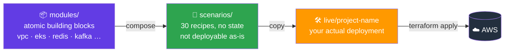

<div align="center">

# 🚀 aws-launcher

**Pick a scenario. Copy it. Ship it.**

A reusable Terraform launchpad for AWS — atomic modules, composed scenarios, and an IaC quality pipeline with Google-SRE principles baked in from day one, not bolted on later.


</div>

---

## 🧭 The mental model



**Why copy instead of `source = "../../scenarios/x"`?** Once `live/<project>` is copied, it's yours — free to adapt, and it won't shift under you if the scenario template improves later. The tradeoff: improvements don't auto-propagate to already-deployed projects. That's intentional — production infrastructure shouldn't move just because a template changed.

---

## 📋 Table of contents

- [Starting a new project](#-starting-a-new-project)
- [One-time setup](#-one-time-setup)
- [Testing modules](#-testing-modules)
- [Custom policy checks](#-custom-policy-checks)
- [Tech stack & techniques](#-tech-stack--techniques)
- [SRE principles applied to every scenario](#-sre-principles-applied-to-every-scenario)
- [Modules (36)](#-modules-36)
- [Scenarios (30)](#-scenarios-30)
- [Formal specifications (TLA+)](#-formal-specifications-tla)
- [Reference example](#-reference-example)
- [Learning backlog](#-learning-backlog)

---

## 🏁 Starting a new project

1. Pick the closest match under `scenarios/` — see the [full list](#-scenarios-30).
2. Copy it: `cp -r scenarios/<slug> live/<your-project-name>`
3. Fill in `backend.tf` (bucket name from `bootstrap/`), `providers.tf` region, and `variables.tf` / a new `terraform.tfvars`.
4. Fill in `SLO.md` with real availability/latency targets for this project.
5. `terraform init && terraform plan` locally, then open a PR — `terraform-ci.yml` runs fmt/validate/tflint/trivy/checkov/conftest/terraform-test and posts a plan + cost diff as PR comments.
6. Merge to `main` → `terraform-apply.yml` applies (gated behind manual approval on the `production` GitHub Environment).

## ⚙️ One-time setup

| Step | What to do |
|---|---|
| 🪣 State backend | Run `bootstrap/` once per AWS account/region to create the S3 state bucket. Locking is S3-native (`use_lockfile`, Terraform >= 1.11) — no DynamoDB table needed (see `bootstrap/README.md`) |
| 🔑 CI credentials | Use `modules/iam-github-oidc` to create two roles — a narrow `plan` role (`AWS_PLAN_ROLE_ARN`) and a broader `apply` role restricted to `refs/heads/main` (`AWS_APPLY_ROLE_ARN`). No long-lived AWS keys in GitHub, ever |
| 💰 Infracost | Add an `INFRACOST_API_KEY` repo secret (free key from infracost.io) |
| 💻 Local dev | `pip install pre-commit && pre-commit install`, then `brew install terraform-docs checkov conftest k6` for the tools that also run outside CI |

## 🧪 Testing modules

`modules/vpc`, `modules/s3-bucket`, and `modules/iam-github-oidc` ship with `tests/*.tftest.hcl` using Terraform's native test framework + `mock_provider` — **no AWS credentials needed, runs in seconds**:

```bash
cd modules/vpc && terraform init -backend=false && terraform test
```

Extend this pattern as more modules get picked up from the [learning backlog](#-learning-backlog); `terraform-ci.yml` automatically runs `terraform test` for any module with a `tests/` directory.

## 🛡️ Custom policy checks

`policy/` holds Conftest (OPA/Rego) policies run against `terraform plan` JSON — the layer generic scanners can't cover, since Trivy/Checkov catch *known* misconfigurations while Conftest enforces *this repo's own* rules (e.g. no public S3 buckets, no matter how a future scenario tries to declare one). See `policy/README.md` for the deny-vs-warn convention.

## 🧱 Tech stack & techniques

Everything used in this repo, gathered in one place — this list *is* the syllabus for the [learning backlog](#-learning-backlog): each row is something to actually understand, not just install.

Organized by **scope**, not by "module vs scenario" — nearly every tool here runs identically against both, since a scenario is just modules composed together. The scope that actually differs is *how much has to exist before the tool can run*:

- **Module-scope**: works on one module in isolation, no composition, often no AWS credentials
- **Composed-stack-scope**: needs a real `terraform plan` of modules wired together (i.e. a `scenarios/*` recipe copied into `live/*`)

### Core (applies everywhere)

| Purpose | Tool/technique |
|---|---|
| IaC language & runtime | Terraform >= 1.5 (>= 1.11 for `live/*` stacks — S3-native locking), HCL, AWS provider `~> 5.0` |
| State backend | S3 (versioned, encrypted) |
| State locking | **S3-native locking** (`use_lockfile = true`, Terraform >= 1.11) — DynamoDB-based locking is upstream-deprecated; `bootstrap/` doesn't create a lock table anymore |
| Version control | Git + GitHub (`gh` CLI for repo/PR management) |
| CI/CD | GitHub Actions (`terraform-ci`, `terraform-apply`, `drift-detect`) |
| CI credentials | GitHub OIDC federation (`iam-github-oidc`) — no long-lived AWS keys ever hit GitHub |

### Module-scope verification (one module, no composition needed)

| Tool/technique | What it checks | Blocking in CI? |
|---|---|:---:|
| `terraform validate`, `terraform fmt` | Does the HCL even parse and format correctly | ✅ |
| TFLint (+ AWS ruleset) | AWS-specific footguns (deprecated arguments, invalid instance types, etc.) | ✅ |
| **`precondition`/`postcondition`** (`lifecycle` blocks) — in **all 36 modules** | "This value must always hold" — checked on **every** plan/apply, not just in test suites. This is the in-ecosystem alternative to something like TLA+: Terraform modules are declarative resource graphs, not concurrent algorithms, so there's no meaningful state space for a model checker to explore — but the *goal* TLA+ serves (explicit, checked invariants) maps directly onto `precondition`/`postcondition` and `check` blocks | ✅ (fails the apply) |
| `terraform test` (native, `mock_provider`) | Module behavior across input combinations, fully offline, no AWS credentials | ✅ for modules with `tests/` |
| terraform-docs | Every module's Inputs/Outputs table (`<!-- BEGIN_TF_DOCS -->` block) is real, not stale | ✅ fails on drift |
| gitleaks | Secrets accidentally committed | ✅ (both pre-commit *and* CI — see note) |

> **Why gitleaks runs in both places:** pre-commit catches it before a commit even happens, but pre-commit only runs if a contributor has it installed. CI is the backstop that catches it regardless — a repo that only scans secrets in pre-commit has a gap for anyone who skips it.

### Composed-stack-scope (needs a real plan of modules wired together)

| Tool/technique | What it checks | Blocking in CI? |
|---|---|:---:|
| Trivy (config scan) | Known AWS misconfigurations | ⚠️ non-blocking, see note |
| Checkov (2nd opinion) | Same category, different detection coverage — a mature IaC stack runs two in parallel | ⚠️ non-blocking, see note |
| Conftest (OPA/Rego), `policy/` | *This repo's own* rules, not generic ones (e.g. no public S3 buckets, no matter how a future scenario tries) | `deny` ✅ / `warn` ❌ |
| Infracost | Cost diff — informational PR comment | ❌ not blocking |
| k6 (`tools/loadtest/`) | Rehearses traffic spikes against each stack's `SLO.md` thresholds | manual, not wired into CI yet |
| Scheduled `terraform plan -detailed-exitcode` (drift detection) | Real infra silently diverging from code (driftctl is unmaintained — this is the practical current alternative) | opens a tracking issue, doesn't block PRs |

> **Why Trivy/Checkov are non-blocking here:** this repo's modules are intentionally minimal (see each module's *"Not yet included"* section) — e.g. Redshift isn't KMS-encrypted, SNS/SQS aren't encrypted by default. Both scanners correctly flag these as real findings; they're accepted trade-offs at the scaffold stage, not bugs. They still run and report on every PR for visibility (`continue-on-error`). Flip a specific project to blocking once a scenario graduates from scaffold to a real production workload.

### Local dev orchestration

| Tool | Runs |
|---|---|
| pre-commit | fmt, validate, tflint, terraform-docs, trivy, checkov, gitleaks — before every commit |

## 🎯 SRE principles applied to every scenario

1. **SLI/SLO first** — every `live/<project>` carries an `SLO.md` (availability, latency, error budget policy).
2. **Observability from day one** — `modules/observability` (CloudWatch baseline, Prometheus/Grafana for EKS scenarios) is part of the recipe, not an afterthought.
3. **Spike-ready autoscaling** — Karpenter on EKS, ElastiCache read replicas, MSK partition scaling, ALB/API Gateway throttling.
4. **Load testing before trust** — `tools/loadtest/` k6 templates rehearse sudden spikes (Google/Spotify-style) against the SLO thresholds.
5. **Multi-AZ by default**, multi-region only where a scenario specifically needs it.

## 📦 Modules (36)

All 36 are implemented (minimal, default-heavy — a working baseline, not every feature) and pass `terraform validate`. Every module README has a `## 공식문서` section with real AWS/Terraform doc links plus a *"Not yet included"* section documenting its gaps on purpose.

<details>
<summary><strong>Show all 36 modules by tier</strong></summary>

| Tier | Modules |
|---|---|
| 🏗️ Foundation | `vpc` · `s3-bucket` · `iam-github-oidc` · `iam` · `ec2` |
| 🖥️ Compute/network | `eks` · `ecs-service` · `elasticache-redis` · `msk-kafka` · `rds-postgres` · `observability` |
| 1️⃣ General-purpose primitives | `alb` · `acm` · `route53` · `kms` · `secrets-manager` · `ecr` |
| 2️⃣ Serverless | `lambda` · `dynamodb` · `api-gateway` · `sns-sqs` · `eventbridge` · `cloudfront` |
| 3️⃣ Data/analytics | `glue` · `athena` · `redshift` · `dms` · `step-functions` |
| 4️⃣ ML/AI & governance | `sagemaker` · `bedrock-opensearch` · `organizations-landing-zone` · `waf-shield` · `aws-backup` · `codedeploy` · `vpc-endpoints` |
| 📨 Messaging (niche) | `amazon-mq` — only for AMQP/MQTT/STOMP protocol compatibility; `sns-sqs` is the default choice for anything new |

</details>

## 🧩 Scenarios (30)

All 30 are **composed** — module calls wired together, `terraform validate` passing — not just README stubs. Each scenario README has a real `## 참고자료` section (official AWS docs + related module links) and any `알려진 제약` (known gap) called out where a real-world detail didn't fit the minimal-default philosophy (e.g. `blue-green-deployment`'s ECS deployment controller, `high-traffic-spike`'s EKS node security group wiring).

<details>
<summary><strong>Show all 30 scenarios by category</strong></summary>

| # | Scenario | Category |
|---|---|---|
| 1 | `standard-web` | 🌐 웹/API |
| 2 | `high-traffic-spike` | 🌐 웹/API |
| 3 | `serverless-api` | 🌐 웹/API |
| 4 | `static-site-cdn` | 🌐 웹/API |
| 5 | `multi-tenant-saas` | 🌐 웹/API |
| 6 | `real-time-streaming` | 🗄️ 데이터/스트리밍 |
| 7 | `data-lake` | 🗄️ 데이터/스트리밍 |
| 8 | `data-warehouse` | 🗄️ 데이터/스트리밍 |
| 9 | `cdc-pipeline` | 🗄️ 데이터/스트리밍 |
| 10 | `etl-batch` | 🗄️ 데이터/스트리밍 |
| 11 | `read-heavy-caching` | ⚡ 캐싱/성능 |
| 12 | `session-store` | ⚡ 캐싱/성능 |
| 13 | `event-driven-microservices` | 📨 이벤트/메시징 |
| 14 | `pub-sub-fanout` | 📨 이벤트/메시징 |
| 15 | `scheduled-batch-jobs` | 📨 이벤트/메시징 |
| 16 | `ml-training-pipeline` | 🤖 ML/AI |
| 17 | `ml-realtime-inference` | 🤖 ML/AI |
| 18 | `llm-rag-service` | 🤖 ML/AI |
| 19 | `multi-account-landing-zone` | 🔒 네트워크/보안 |
| 20 | `private-vpc-only` | 🔒 네트워크/보안 |
| 21 | `zero-trust-edge` | 🔒 네트워크/보안 |
| 22 | `multi-region-active-active` | 🌍 가용성/재해복구 |
| 23 | `disaster-recovery-pilot-light` | 🌍 가용성/재해복구 |
| 24 | `backup-restore-baseline` | 🌍 가용성/재해복구 |
| 25 | `eks-multi-tenant-cluster` | 🚢 컨테이너/배포전략 |
| 26 | `ecs-fargate-microservices` | 🚢 컨테이너/배포전략 |
| 27 | `blue-green-deployment` | 🚢 컨테이너/배포전략 |
| 28 | `canary-deployment` | 🚢 컨테이너/배포전략 |
| 29 | `observability-only-baseline` | 📊 운영/비용 |
| 30 | `cost-optimized-spot-fleet` | 📊 운영/비용 |

</details>

## 📐 Formal specifications (TLA+)

`specs/` has a [TLA+](https://lamport.azurewebsites.net/tla/tla.html) spec + TLC model-checker config for **every one of the 30 scenarios**, modeling *runtime* behavior that `precondition`/`postcondition` can't reach (those only see one `plan`/`apply` snapshot). Each spec is small on purpose: a handful of state variables and one or two properties that capture that scenario's actual interesting risk — e.g. Lambda concurrency limits (`serverless-api`), SQS at-least-once + idempotency (`event-driven-microservices`), DMS Full Load → CDC ordering (`cdc-pipeline`), asynchronous multi-region replication (`multi-region-active-active`).

TLC found real bugs this way, not just style nits — including a bug *in a bug fix*:

- **`serverless-api`**: the first cut let `warmInstances` grow past `MaxConcurrency` — TLC's counter-example caught it immediately.
- **`observability-only-baseline`**: a naive liveness claim ("burning eventually fires the alarm") had a flapping counter-example TLC found; the fix was correcting the property to require *sustained* burning — except the first rewrite of that fix (`[]burning => <>Firing`) was itself **vacuously true** (`burning` starts `FALSE`, so `[]burning` is false at t=0 for every behavior, making the whole implication trivially true regardless of what the spec actually does). The real fix is `(<>[]burning) => (<>Firing)`, confirmed non-vacuous by checking it holds *with* fairness and fails *without* it.
- **`ml-training-pipeline`**: the same vacuous-property mistake, found by auditing every `PROPERTY` in the repo after the bug above — `(state = "Completed") => [](state = "Completed")` without an outer `[]` is vacuously true the same way. Confirmed by injecting a deliberate `Completed -> InProgress` bug into `Next` and watching TLC still report "No error" until the outer `[]` was added.

The lesson generalizes: `"No error has been found"` only means something if the property was checked against a real counter-example first. All 4 temporal `PROPERTY` declarations in the repo were audited this way — the other 2 (`multi-region-active-active`, `pub-sub-fanout`) use the built-in `~>` leads-to operator, which doesn't have this trap, and both were confirmed to actually fail without their fairness conditions.

`specs/modules/` does the same thing for every one of the **36 modules**, but from a different angle: no concurrency, no state machine — each module is specified as input (`variables.tf`) → operation (the AWS API calls `main.tf` triggers) → output (`outputs.tf` + what it must always guarantee), checked by TLC against one concrete example rather than proved for every input. Writing these surfaced 3 real gaps, fixed directly: `dms` allowed `target_engine_name = "kafka"` with no broker set, `redshift` never exposed the `master_password_secret_arn` its own `manage_master_password = true` already creates, and `amazon-mq` never validated its own 12-character minimum password length.

See [`specs/README.md`](specs/README.md) and [`specs/modules/README.md`](specs/modules/README.md) for tool setup (`tla2tools.jar` is downloaded, not vendored) and how to run TLC yourself. Why TLA+ applies differently at each scope: [`decision-2`](backlog/decisions) (module-scope precondition/postcondition, not concurrency modeling) vs [`decision-3`](backlog/decisions) (scenario-scope runtime state machines) vs [`decision-4`](backlog/decisions) (module-scope input/operation/output).

## 🔍 Reference example

`live/example-dev` is a minimal, actually-`plan`-able stack (vpc + s3-bucket only) proving the pipeline end to end. `scenarios/standard-web` now has the fuller composition (ALB+ECS+RDS+observability); `example-dev` stays as the simplest possible smoke test of the CI/CD plumbing itself.

## 🎓 Learning backlog

This repo doubles as a learning project, tracked with the [Backlog.md](https://github.com/MrLesk/Backlog.md) CLI in `backlog/` — not a plain markdown file, so status/relationships stay structured. Always go through the `backlog` CLI to read or change it (`backlog task list --plain`, `backlog board`, `backlog overview`), not by hand-editing files under `backlog/`.

**Structure — Epic → Story → Task:**

- **17 milestones** (epics) — one per module tier / scenario category (e.g. "Foundation Modules", "Web/API Scenarios"), plus **Formal Specifications (TLA+)** covering all 30 scenario-level specs and all 36 module-level specs
- **132 parent tasks** (stories), type `spike` — one per module (36), scenario (30), scenario-level TLA+ spec (30), and module-level TLA+ spec (36), each conceptual (what to understand, why it matters), left `To Do` for you to actually work through — nothing is pre-completed
- **162 child tasks**, type `task`/`docs` — module/scenario stories get one hands-on child (type the code out, then run the *actual* toolchain: `terraform validate`, `tflint`, `terraform-docs`, `terraform test` where it exists, `checkov`/`trivy`); scenario-level TLA+ stories get two children: one hands-on (type `spec.tla` out, run TLC, and for specs where TLC caught something during authoring, a guided step to reproduce that exact failure yourself) plus one docs-deepening child; module-level TLA+ stories get one hands-on child (type `spec.tla` out, run TLC, then deliberately break `Provision` and confirm TLC catches it)

Run `backlog board` for a Kanban view, or `backlog task list --plain -m "Foundation Modules"` to see one epic's stories.

**Other `backlog/` directories, and what they're for:**

| Directory | Created via | Use it for |
|---|---|---|
| `backlog/docs/` | `backlog doc create "title" -p some/path` | Prose learning notes — what you actually figured out after reading the docs, as opposed to the task's checklist of what to figure out. See `backlog/docs/learning-notes/vpc/` for a starter template — copy the pattern per module as you work through it. |
| `backlog/decisions/` | `backlog decision create "title" -s accepted` | ADR-style decision records — *why* we chose X over Y. Four real ones already in there: switching to S3-native state locking, choosing `precondition`/`postcondition` over TLA+ concurrency-modeling at the module scope, adopting TLA+ for scenario-scope runtime state machines, and adopting a *different* use of TLA+ (input/operation/output, no concurrency) at the module scope too. Worth writing one whenever a non-obvious call gets made, not just for learning-project decisions. |
| `backlog/drafts/` | `backlog draft create "title"` | Half-formed task ideas not ready to commit to yet — promote with `backlog draft promote <id>` once scoped. |
| `backlog/milestones/` | `backlog milestone add "title"` | The epics themselves (see above) — rarely touched directly once the 17 exist. |

