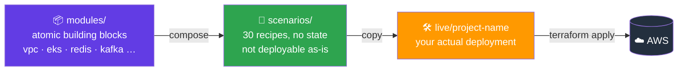

<div align="center">

**🇺🇸 English** · [🇰🇷 한국어](README.ko.md)

# 🚀 aws-launcher

**Pick a scenario. Copy it. Ship it.**

A personal Terraform launchpad for AWS — atomic modules, composed scenarios, formally-specified runtime behavior, and an IaC quality pipeline, built as a hands-on way to actually learn this stuff rather than just read about it.


</div>

---

> 🎓 **This is a personal learning project, built together with Claude.** Not a polished product, not a company's official IaC library — one person's hands-on tooling for actually learning Terraform, AWS, SRE practice, and formal specification (TLA+) by building something real with an AI pairing partner, mistakes included. Every module, scenario, and TLA+ spec here came out of that ongoing session with [Claude](https://claude.com/claude-code) — the design decisions, the real bugs a security scanner or a model checker actually caught (and the ones that turned out to be false positives), and the [`backlog.md`](#-learning-backlog) learning tasks left for the human to actually work through, are all part of that process, not a finished thing to copy blindly. Read `backlog/decisions/` for the *why* behind the non-obvious calls, and [Repo metrics](#-repo-metrics) for what the tools actually find when pointed at this code — including the things that are still open.

---

## 🧭 The mental model



**Why copy instead of `source = "../../scenarios/x"`?** Once `live/<project>` is copied, it's yours — free to adapt, and it won't shift under you if the scenario template improves later. The tradeoff: improvements don't auto-propagate to already-deployed projects. That's intentional — production infrastructure shouldn't move just because a template changed.

---

## 📋 Table of contents

- [Starting a new project](#-starting-a-new-project)
- [One-time setup](#-one-time-setup)
- [Testing modules](#-testing-modules)
- [Custom policy checks](#-custom-policy-checks)
- [Tech stack & techniques](#-tech-stack--techniques)
- [Repo metrics](#-repo-metrics)
- [SRE principles applied to every scenario](#-sre-principles-applied-to-every-scenario)
- [Modules (36)](#-modules-36)
- [Scenarios (30)](#-scenarios-30)
- [Formal specifications (TLA+)](#-formal-specifications-tla)
- [Reference example](#-reference-example)
- [Learning backlog](#-learning-backlog)

---

## 🏁 Starting a new project

1. Pick the closest match under `scenarios/` — see the [full list](#-scenarios-30).
2. Copy it: `cp -r scenarios/<slug> live/<your-project-name>`
3. Fill in `backend.tf` (bucket name from `bootstrap/`), `providers.tf` region, and `variables.tf` / a new `terraform.tfvars`.
4. Fill in `SLO.md` with real availability/latency targets for this project.
5. `terraform init && terraform plan` locally, then open a PR — `terraform-ci.yml` runs fmt/validate/tflint/trivy/checkov/conftest/terraform-test and posts a plan + cost diff as PR comments.
6. Merge to `main` → `terraform-apply.yml` applies (gated behind manual approval on the `production` GitHub Environment).

## ⚙️ One-time setup

| Step | What to do |
|---|---|
| 🪣 State backend | Run `bootstrap/` once per AWS account/region to create the S3 state bucket. Locking is S3-native (`use_lockfile`, Terraform >= 1.11) — no DynamoDB table needed (see `bootstrap/README.md`) |
| 🔑 CI credentials | Use `modules/iam-github-oidc` to create two roles — a narrow `plan` role (`AWS_PLAN_ROLE_ARN`) and a broader `apply` role restricted to `refs/heads/main` (`AWS_APPLY_ROLE_ARN`). No long-lived AWS keys in GitHub, ever |
| 💰 Infracost | Add an `INFRACOST_API_KEY` repo secret (free key from infracost.io) |
| 💻 Local dev | `pip install pre-commit && pre-commit install`, then `brew install terraform-docs checkov conftest k6` for the tools that also run outside CI |

## 🧪 Testing modules

`modules/vpc`, `modules/s3-bucket`, and `modules/iam-github-oidc` ship with `tests/*.tftest.hcl` using Terraform's native test framework + `mock_provider` — **no AWS credentials needed, runs in seconds**:

```bash
cd modules/vpc && terraform init -backend=false && terraform test
```

Extend this pattern as more modules get picked up from the [learning backlog](#-learning-backlog); `terraform-ci.yml` automatically runs `terraform test` for any module with a `tests/` directory.

## 🛡️ Custom policy checks

`policy/` holds Conftest (OPA/Rego) policies run against `terraform plan` JSON — the layer generic scanners can't cover, since Trivy/Checkov catch *known* misconfigurations while Conftest enforces *this repo's own* rules (e.g. no public S3 buckets, no matter how a future scenario tries to declare one). See `policy/README.md` for the deny-vs-warn convention.

## 🧱 Tech stack & techniques

Everything used in this repo, gathered in one place — this list *is* the syllabus for the [learning backlog](#-learning-backlog): each row is something to actually understand, not just install.

Organized by **scope**, not by "module vs scenario" — nearly every tool here runs identically against both, since a scenario is just modules composed together. The scope that actually differs is *how much has to exist before the tool can run*:

- **Module-scope**: works on one module in isolation, no composition, often no AWS credentials
- **Composed-stack-scope**: needs a real `terraform plan` of modules wired together (i.e. a `scenarios/*` recipe copied into `live/*`)

### Core (applies everywhere)

| Purpose | Tool/technique |
|---|---|
| IaC language & runtime | Terraform >= 1.5 (>= 1.11 for `live/*` stacks — S3-native locking), HCL, AWS provider `~> 5.0` |
| State backend | S3 (versioned, encrypted) |
| State locking | **S3-native locking** (`use_lockfile = true`, Terraform >= 1.11) — DynamoDB-based locking is upstream-deprecated; `bootstrap/` doesn't create a lock table anymore |
| Version control | Git + GitHub (`gh` CLI for repo/PR management) |
| CI/CD | GitHub Actions (`terraform-ci`, `terraform-apply`, `drift-detect`) |
| CI credentials | GitHub OIDC federation (`iam-github-oidc`) — no long-lived AWS keys ever hit GitHub |

### Module-scope verification (one module, no composition needed)

| Tool/technique | What it checks | Blocking in CI? |
|---|---|:---:|
| `terraform validate`, `terraform fmt` | Does the HCL even parse and format correctly | ✅ |
| TFLint (+ AWS ruleset) | AWS-specific footguns (deprecated arguments, invalid instance types, etc.) | ✅ |
| **`precondition`/`postcondition`** (`lifecycle` blocks) — in **all 36 modules** | "This value must always hold" — checked on **every** plan/apply, not just in test suites. This is the in-ecosystem alternative to something like TLA+: Terraform modules are declarative resource graphs, not concurrent algorithms, so there's no meaningful state space for a model checker to explore — but the *goal* TLA+ serves (explicit, checked invariants) maps directly onto `precondition`/`postcondition` and `check` blocks | ✅ (fails the apply) |
| `terraform test` (native, `mock_provider`) | Module behavior across input combinations, fully offline, no AWS credentials | ✅ for modules with `tests/` |
| terraform-docs | Every module's Inputs/Outputs table (`<!-- BEGIN_TF_DOCS -->` block) is real, not stale | ✅ fails on drift |
| gitleaks | Secrets accidentally committed | ✅ (both pre-commit *and* CI — see note) |

> **Why gitleaks runs in both places:** pre-commit catches it before a commit even happens, but pre-commit only runs if a contributor has it installed. CI is the backstop that catches it regardless — a repo that only scans secrets in pre-commit has a gap for anyone who skips it.

### Composed-stack-scope (needs a real plan of modules wired together)

| Tool/technique | What it checks | Blocking in CI? |
|---|---|:---:|
| Trivy (config scan) | Known AWS misconfigurations | ⚠️ non-blocking, see note |
| Checkov (2nd opinion) | Same category, different detection coverage — a mature IaC stack runs two in parallel | ⚠️ non-blocking, see note |
| Conftest (OPA/Rego), `policy/` | *This repo's own* rules, not generic ones (e.g. no public S3 buckets, no matter how a future scenario tries) | `deny` ✅ / `warn` ❌ |
| Infracost | Cost diff — informational PR comment | ❌ not blocking |
| k6 (`tools/loadtest/`, `.github/workflows/loadtest.yml`) | Rehearses traffic spikes against each stack's `SLO.md` thresholds | manual `workflow_dispatch` — no AWS credentials, see `tools/loadtest/README.md` |
| Scheduled `terraform plan -detailed-exitcode` (drift detection) | Real infra silently diverging from code (driftctl is unmaintained — this is the practical current alternative) | opens a tracking issue, doesn't block PRs |

> **Why Trivy/Checkov are non-blocking here:** this repo's modules are intentionally minimal (see each module's *"Not yet included"* section) — e.g. Redshift isn't KMS-encrypted, SNS/SQS aren't encrypted by default. Both scanners correctly flag these as real findings; they're accepted trade-offs at the scaffold stage, not bugs. They still run and report on every PR for visibility (`continue-on-error`). Flip a specific project to blocking once a scenario graduates from scaffold to a real production workload.

### Local dev orchestration

| Tool | Runs |
|---|---|
| pre-commit | fmt, validate, tflint, terraform-docs, trivy, checkov, gitleaks — before every commit |

## 📊 Repo metrics

What the tools above actually find when run against this repo right now — not aspirational, a real snapshot, and one that's already been through a full audit pass (see below):

| Metric | Result |
|---|---|
| tflint (`modules/`) | 0 errors/warnings, 0 `info`-level notices — the 322 that used to be here (missing `description` on variables/outputs) are fixed, see below |
| tflint (`scenarios/`, `bootstrap/`, `live/`) | 112 `info`-level notices, same rule, never previously audited (the original 322 count only ever covered `modules/`) — newly found, tracked as [`TASK-176`](backlog/tasks) |
| checkov (36 modules) | 338 passed / 19 failed (94.7%) — every remaining failure has a matching *"Not yet included"* note in that module's README, and most are tracked as explicit backlog tasks (see below) |
| trivy config (36 modules) | 30 misconfigurations flagged — same category as checkov, second-opinion scanner, same audit coverage |
| `precondition`/`postcondition` blocks | 37 (34 precondition + 3 postcondition) — real AWS-API invariants enforced on every `plan`/`apply` |
| `terraform test` files | 3 (`vpc`, `s3-bucket`, `iam-github-oidc`) |
| Conftest policies (`policy/`) | 2 (1 `deny`, 1 `warn`) |
| gitleaks (full git history) | 0 leaks |
| TLA+ / TLC (66 specs: 30 scenarios + 36 modules) | 0 failing, reconfirmed after every module fix below |
| Lines of code ([tokei](https://github.com/XAMPPRocky/tokei)) | 6,030+ HCL · 3,925 TLA+ (`tokei` doesn't recognize `.tla`, counted separately) · 316 backlog learning-task files (11,736 lines) |
| Infracost | not run locally — confirmed by actually trying: the latest CLI (`v2.16.2` via Homebrew) requires a browser OAuth login even for `infracost scan`, and `infracost diff`/`infracost comment` (what CI uses) are deprecated *in that version*. The CI workflow itself is fine: `infracost/actions/setup@v3` pins CLI `0.10.x` by default, where `diff`/`comment` are still the correct, working commands — so this is purely a "can't run the newest CLI interactively on your behalf" gap, not a broken pipeline. You still need to `infracost auth login` once yourself to get the `INFRACOST_API_KEY` for the repo secret (see [One-time setup](#-one-time-setup)) |

### The checkov/trivy audit (what actually happened)

The first pass of this table said "79 checkov / 52 trivy failures, not yet cross-checked against documentation." That audit happened — findings dropped from 79→45 (checkov) and 52→40 (trivy; one new finding appeared along the way — see the `dms` note below — so it's not a clean drop), split three ways:

- **Fixed for free** (~20 findings): security group rule descriptions, `auto_minor_version_upgrade`, SNS/SQS/Athena default encryption with AWS-managed keys, CloudFront `default_root_object`/TLS 1.2 minimum, ALB header-dropping, Lambda X-Ray tracing, Step Functions logging + tracing, WAF's Log4Shell rule set, RDS IAM auth + Performance Insights, SageMaker network isolation.
- **Fixed because they were real security gaps, not just scanner nits**: `ecs-service` had its container port open to `0.0.0.0/0` even behind an ALB — now scoped to the ALB's security group when one exists. `redshift` had no `publicly_accessible` set at all, and Redshift (unlike RDS) actually defaults that to `true` — now explicit `false`. `dms` had no security group whatsoever, silently falling back to the VPC's default SG — now has one (egress-only, since it only makes outbound connections). Two of these were found via a leftover `tflint` unused-variable warning (`vpc_id` declared but never used) that turned out to be pointing at real missing infrastructure, not dead code.
- **Left as documented trade-offs** (the rest): mostly "use a customer-managed KMS key" (encryption is already on everywhere via AWS-managed keys — this is about who manages the key) and things needing real new infrastructure (access-log buckets, enhanced monitoring's IAM role, VPC-attached Lambda). Every one of these has a specific note in its module's README, not just a generic "intentionally minimal" hand-wave.

One thing this audit exposed about itself: `tflint`'s "0 findings" claim in an earlier version of this table was **wrong** — the `aws` plugin had silently failed to load (a stale plugin cache), so most of the repo was never actually being checked, and it looked clean by accident. Re-running `tflint --init` surfaced the real number (322 info-level notices, 0 real errors) plus the two `vpc_id` warnings above. Lesson kept for the record: a "0 findings" result is only as trustworthy as confirming the tool actually ran everywhere it was supposed to.

A second `tflint --recursive` scan later turned up the same class of trap from a different angle: run from the repo root, it silently reported **0 issues** across the whole tree — but `tflint` doesn't walk up to find a parent directory's `.tflint.hcl`, it only looks in the exact working directory, so `--recursive` without an explicit `--config "$(pwd)/.tflint.hcl"` drops the custom ruleset the moment it descends into a subdirectory. The real 322 notices only reappeared once `--config` was passed explicitly. Tracked as [`TASK-175`](backlog/tasks) so this doesn't get "fixed" by someone re-running the misleading command and concluding there's nothing left to do.

### Round two: closing the remaining findings (Security & Observability Hardening)

Findings that were "left as documented trade-offs" above got revisited rather than left alone — checkov/trivy were re-run, every remaining failure was logged as an explicit `bug`-type task via the `backlog` CLI under a new milestone, **Security & Observability Hardening** (`m-17` — separate from the module/scenario *learning* milestones below, since these are engineering tasks meant to actually get fixed, not concepts left for a human to work through). As of the last pass, **42 of 43** of those tasks are closed: **checkov 45→19 failures (94.7% passing)**, **trivy 40→30**. The remaining backlog under `m-17` is the honest list of what's still open — see [`backlog/tasks`](backlog/tasks) or run `backlog task list -m "Security & Observability Hardening" --plain`.

What actually got fixed, roughly in the order it happened:
- **Optional customer-managed KMS keys** added to 15 modules (`dms`, `amazon-mq`, `dynamodb`, `ecr`, `secrets-manager`, `aws-backup`, `rds-postgres`, `redshift`, `sns-sqs`, `observability`, `s3-bucket`, `lambda`, `step-functions`, `elasticache-redis`, `glue`, `msk-kafka`) — every one is a nullable variable defaulting to the AWS-managed key (non-breaking, opt-in, no forced cost).
- **Real capability gaps closed for free**, unconditional and previously entirely absent rather than just defaulted off: `amazon-mq`, `msk-kafka`, and `api-gateway` access/broker logging, `redshift` enhanced VPC routing.
- **Real capability gaps closed as opt-in** (real cost when enabled, off by default): `eks` control-plane logging + `public_access_cidrs`, `elasticache-redis` AUTH token, `vpc` flow logs, `ec2` detailed monitoring, `ecs-service` Container Insights, `alb`/`cloudfront` deletion protection/access logging/WAF association/geo restriction, `rds-postgres` log exports + enhanced monitoring (its own IAM role, created only when enabled), `redshift` audit logging, `lambda` DLQ/concurrency limit/env-var KMS/VPC attachment/code-signing, `step-functions` log retention, `api-gateway` route-level authorization (`authorization_type`/`authorizer_id`, defaulting to `"NONE"`/`null` — not forced on, since requiring an authorizer by default would be a breaking change for every existing caller).
- **A backlog bookkeeping bug found and fixed along the way**: a couple of task-ID off-by-one mistakes in this session's own fork instructions left 4 tasks with the wrong status (2 marked "Done" for work that was never built — `rds-postgres` enhanced monitoring, `lambda` code-signing — and 2 left "To Do" for work that was already shipped — `rds-postgres` log exports, `lambda` DLQ). Caught by verifying every task's title against the actual code rather than trusting either the fork reports or the task IDs at face value, and corrected before those two "Done" items got built for real.

`m-17` is now fully closed (43/43) — the last item, the 322 `tflint` description notices across all 36 modules, was fixed via four parallel forks (one per 9-module batch), each verified with `tflint --config="$(pwd)/.tflint.hcl"` per module and re-validated with `terraform validate`. That same pass surfaced a follow-on finding while confirming the fix with a full-repo `--recursive` scan: `scenarios/`, `bootstrap/`, and `live/` have their own 112 undocumented variables/outputs, never covered by the original 322 count (which was `modules/`-only) or audited before — logged as [`TASK-176`](backlog/tasks) under a fresh milestone for the next pass.

## 🎯 SRE principles this repo aims for (and where it honestly falls short)

The intent, stated plainly, and the actual state rather than the aspiration:

1. **SLI/SLO first** — every `live/<project>` carries an `SLO.md` (availability, latency, error budget policy). Implemented.
2. **Observability from day one** — `modules/observability` (CloudWatch baseline) is part of the recipe, not an afterthought. **Not yet implemented**: Prometheus/Grafana (AMP/AMG) for EKS scenarios — see `modules/observability`'s own *"Not yet included"* note.
3. **Spike-ready autoscaling** — ElastiCache read replicas and MSK partition/broker scaling are real (see those modules' `precondition` blocks). **Not yet implemented**: Karpenter on EKS (the `eks` module's README documents this gap directly — it's the whole reason `high-traffic-spike` exists as a scenario, and it isn't wired up yet), and there's no ALB/API Gateway throttling configuration anywhere in this repo yet.
4. **Load testing before trust** — `tools/loadtest/` k6 templates rehearse sudden spikes, wired into CI as a manual `workflow_dispatch` job (`.github/workflows/loadtest.yml`). Implemented, but the thresholds in `basic-load.js` are still placeholders per scenario.
5. **Multi-AZ by default**, multi-region only where a scenario specifically needs it. Implemented (see the `precondition` blocks requiring ≥2 AZs on `vpc`, `alb`, `eks`, `msk-kafka`).

## 📦 Modules (36)

All 36 are implemented (minimal, default-heavy — a working baseline, not every feature) and pass `terraform validate`. Every module README has a `## 공식문서` section with real AWS/Terraform doc links plus a *"Not yet included"* section documenting its gaps on purpose.

<details>
<summary><strong>Show all 36 modules by tier</strong></summary>

| Tier | Modules |
|---|---|
| 🏗️ Foundation | `vpc` · `s3-bucket` · `iam-github-oidc` · `iam` · `ec2` |
| 🖥️ Compute/network | `eks` · `ecs-service` · `elasticache-redis` · `msk-kafka` · `rds-postgres` · `observability` |
| 1️⃣ General-purpose primitives | `alb` · `acm` · `route53` · `kms` · `secrets-manager` · `ecr` |
| 2️⃣ Serverless | `lambda` · `dynamodb` · `api-gateway` · `sns-sqs` · `eventbridge` · `cloudfront` |
| 3️⃣ Data/analytics | `glue` · `athena` · `redshift` · `dms` · `step-functions` |
| 4️⃣ ML/AI & governance | `sagemaker` · `bedrock-opensearch` · `organizations-landing-zone` · `waf-shield` · `aws-backup` · `codedeploy` · `vpc-endpoints` |
| 📨 Messaging (niche) | `amazon-mq` — only for AMQP/MQTT/STOMP protocol compatibility; `sns-sqs` is the default choice for anything new |

</details>

## 🧩 Scenarios (30)

All 30 are **composed** — module calls wired together, `terraform validate` passing — not just README stubs. Each scenario README has a real `## 참고자료` section (official AWS docs + related module links) and any `알려진 제약` (known gap) called out where a real-world detail didn't fit the minimal-default philosophy (e.g. `blue-green-deployment`'s ECS deployment controller, `high-traffic-spike`'s EKS node security group wiring).

<details>
<summary><strong>Show all 30 scenarios by category</strong></summary>

| # | Scenario | Category |
|---|---|---|
| 1 | `standard-web` | 🌐 웹/API |
| 2 | `high-traffic-spike` | 🌐 웹/API |
| 3 | `serverless-api` | 🌐 웹/API |
| 4 | `static-site-cdn` | 🌐 웹/API |
| 5 | `multi-tenant-saas` | 🌐 웹/API |
| 6 | `real-time-streaming` | 🗄️ 데이터/스트리밍 |
| 7 | `data-lake` | 🗄️ 데이터/스트리밍 |
| 8 | `data-warehouse` | 🗄️ 데이터/스트리밍 |
| 9 | `cdc-pipeline` | 🗄️ 데이터/스트리밍 |
| 10 | `etl-batch` | 🗄️ 데이터/스트리밍 |
| 11 | `read-heavy-caching` | ⚡ 캐싱/성능 |
| 12 | `session-store` | ⚡ 캐싱/성능 |
| 13 | `event-driven-microservices` | 📨 이벤트/메시징 |
| 14 | `pub-sub-fanout` | 📨 이벤트/메시징 |
| 15 | `scheduled-batch-jobs` | 📨 이벤트/메시징 |
| 16 | `ml-training-pipeline` | 🤖 ML/AI |
| 17 | `ml-realtime-inference` | 🤖 ML/AI |
| 18 | `llm-rag-service` | 🤖 ML/AI |
| 19 | `multi-account-landing-zone` | 🔒 네트워크/보안 |
| 20 | `private-vpc-only` | 🔒 네트워크/보안 |
| 21 | `zero-trust-edge` | 🔒 네트워크/보안 |
| 22 | `multi-region-active-active` | 🌍 가용성/재해복구 |
| 23 | `disaster-recovery-pilot-light` | 🌍 가용성/재해복구 |
| 24 | `backup-restore-baseline` | 🌍 가용성/재해복구 |
| 25 | `eks-multi-tenant-cluster` | 🚢 컨테이너/배포전략 |
| 26 | `ecs-fargate-microservices` | 🚢 컨테이너/배포전략 |
| 27 | `blue-green-deployment` | 🚢 컨테이너/배포전략 |
| 28 | `canary-deployment` | 🚢 컨테이너/배포전략 |
| 29 | `observability-only-baseline` | 📊 운영/비용 |
| 30 | `cost-optimized-spot-fleet` | 📊 운영/비용 |

</details>

## 📐 Formal specifications (TLA+)

`specs/` has a [TLA+](https://lamport.azurewebsites.net/tla/tla.html) spec + TLC model-checker config for **every one of the 30 scenarios**, modeling *runtime* behavior that `precondition`/`postcondition` can't reach (those only see one `plan`/`apply` snapshot). Each spec is small on purpose: a handful of state variables and one or two properties that capture that scenario's actual interesting risk — e.g. Lambda concurrency limits (`serverless-api`), SQS at-least-once + idempotency (`event-driven-microservices`), DMS Full Load → CDC ordering (`cdc-pipeline`), asynchronous multi-region replication (`multi-region-active-active`).

TLC found real bugs this way, not just style nits — including a bug *in a bug fix*:

- **`serverless-api`**: the first cut let `warmInstances` grow past `MaxConcurrency` — TLC's counter-example caught it immediately.
- **`observability-only-baseline`**: a naive liveness claim ("burning eventually fires the alarm") had a flapping counter-example TLC found; the fix was correcting the property to require *sustained* burning — except the first rewrite of that fix (`[]burning => <>Firing`) was itself **vacuously true** (`burning` starts `FALSE`, so `[]burning` is false at t=0 for every behavior, making the whole implication trivially true regardless of what the spec actually does). The real fix is `(<>[]burning) => (<>Firing)`, confirmed non-vacuous by checking it holds *with* fairness and fails *without* it.
- **`ml-training-pipeline`**: the same vacuous-property mistake, found by auditing every `PROPERTY` in the repo after the bug above — `(state = "Completed") => [](state = "Completed")` without an outer `[]` is vacuously true the same way. Confirmed by injecting a deliberate `Completed -> InProgress` bug into `Next` and watching TLC still report "No error" until the outer `[]` was added.

The lesson generalizes: `"No error has been found"` only means something if the property was checked against a real counter-example first. All 4 temporal `PROPERTY` declarations in the repo were audited this way — the other 2 (`multi-region-active-active`, `pub-sub-fanout`) use the built-in `~>` leads-to operator, which doesn't have this trap, and both were confirmed to actually fail without their fairness conditions.

`specs/modules/` does the same thing for every one of the **36 modules**, but from a different angle: no concurrency, no state machine — each module is specified as input (`variables.tf`) → operation (the AWS API calls `main.tf` triggers) → output (`outputs.tf` + what it must always guarantee), checked by TLC against one concrete example rather than proved for every input. Writing these surfaced 3 real gaps, fixed directly: `dms` allowed `target_engine_name = "kafka"` with no broker set, `redshift` never exposed the `master_password_secret_arn` its own `manage_master_password = true` already creates, and `amazon-mq` never validated its own 12-character minimum password length.

See [`specs/README.md`](specs/README.md) and [`specs/modules/README.md`](specs/modules/README.md) for tool setup (`tla2tools.jar` is downloaded, not vendored) and how to run TLC yourself. Why TLA+ applies differently at each scope: [`decision-2`](backlog/decisions) (module-scope precondition/postcondition, not concurrency modeling) vs [`decision-3`](backlog/decisions) (scenario-scope runtime state machines) vs [`decision-4`](backlog/decisions) (module-scope input/operation/output).

## 🔍 Reference example

`live/example-dev` is a minimal, actually-`plan`-able stack (vpc + s3-bucket only) proving the pipeline end to end. `scenarios/standard-web` now has the fuller composition (ALB+ECS+RDS+observability); `example-dev` stays as the simplest possible smoke test of the CI/CD plumbing itself.

## 🎓 Learning backlog

This repo doubles as a learning project, tracked with the [Backlog.md](https://github.com/MrLesk/Backlog.md) CLI in `backlog/` — not a plain markdown file, so status/relationships stay structured. Always go through the `backlog` CLI to read or change it (`backlog task list --plain`, `backlog board`, `backlog overview`), not by hand-editing files under `backlog/`.

**Two different kinds of backlog live side by side under the same CLI** — worth distinguishing since they mean different things when you see them in `backlog board`:

- **Milestones `m-0` through `m-16`** (below) are the *learning* backlog — `spike`/`task`/`docs`-type tasks meant to be worked through by a human, left `To Do` on purpose, never pre-completed on your behalf.
- **Milestone `m-17`, "Security & Observability Hardening"**, is a *different* kind of backlog — `bug`-type engineering tasks logged from real checkov/trivy/tflint findings, meant to actually get fixed. **Complete: 43/43 done**, see [Repo metrics](#-repo-metrics) above for what actually got fixed.

**Structure — Epic → Story → Task (the learning backlog, `m-0`–`m-16`):**

- **17 milestones** (epics) — one per module tier / scenario category (e.g. "Foundation Modules", "Web/API Scenarios"), plus **Formal Specifications (TLA+)** covering all 30 scenario-level specs and all 36 module-level specs
- **132 parent tasks** (stories), type `spike` — one per module (36), scenario (30), scenario-level TLA+ spec (30), and module-level TLA+ spec (36), each conceptual (what to understand, why it matters), left `To Do` for you to actually work through — nothing is pre-completed
- **162 child tasks**, type `task`/`docs` — module/scenario stories get one hands-on child (type the code out, then run the *actual* toolchain: `terraform validate`, `tflint`, `terraform-docs`, `terraform test` where it exists, `checkov`/`trivy`); scenario-level TLA+ stories get two children: one hands-on (type `spec.tla` out, run TLC, and for specs where TLC caught something during authoring, a guided step to reproduce that exact failure yourself) plus one docs-deepening child; module-level TLA+ stories get one hands-on child (type `spec.tla` out, run TLC, then deliberately break `Provision` and confirm TLC catches it)

Run `backlog board` for a Kanban view, or `backlog task list --plain -m "Foundation Modules"` to see one epic's stories.

**Other `backlog/` directories, and what they're for:**

| Directory | Created via | Use it for |
|---|---|---|
| `backlog/docs/` | `backlog doc create "title" -p some/path` | Prose learning notes — what you actually figured out after reading the docs, as opposed to the task's checklist of what to figure out. See `backlog/docs/learning-notes/vpc/` for a starter template — copy the pattern per module as you work through it. |
| `backlog/decisions/` | `backlog decision create "title" -s accepted` | ADR-style decision records — *why* we chose X over Y. Four real ones already in there: switching to S3-native state locking, choosing `precondition`/`postcondition` over TLA+ concurrency-modeling at the module scope, adopting TLA+ for scenario-scope runtime state machines, and adopting a *different* use of TLA+ (input/operation/output, no concurrency) at the module scope too. Worth writing one whenever a non-obvious call gets made, not just for learning-project decisions. |
| `backlog/drafts/` | `backlog draft create "title"` | Half-formed task ideas not ready to commit to yet — promote with `backlog draft promote <id>` once scoped. |
| `backlog/milestones/` | `backlog milestone add "title"` | The epics themselves (see above) — rarely touched directly once the 17 exist. |

